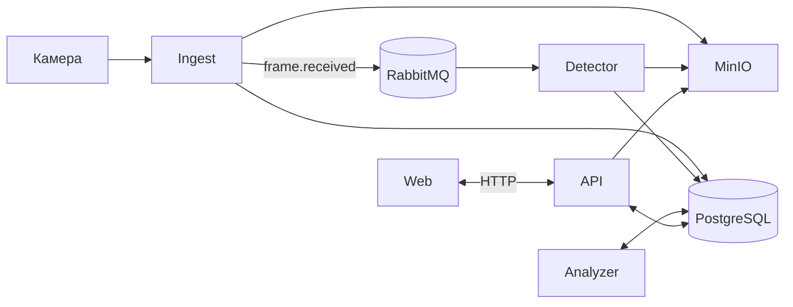

# Архитектура

Система мониторинга строительных площадок: принимает снимки с камер, распознаёт технику, сверяет её с этапами работ и фиксирует отклонения.

## Сервисы

| Сервис | Назначение |
|---|---|
| API | Участки, этапы, камеры, правила, справочники. Чтение состояния |
| Ingest | Приём снимков, сохранение файла, постановка задачи на распознавание |
| Detector | Распознавание техники, запись отчёта |
| Analyzer | Расчёт состояния участков и отклонений по расписанию |
| Front | Интерфейс пользователя |

Инфраструктура: PostgreSQL, RabbitMQ, MinIO.

Описание схемы бд: [database.md](database.md)

## Схема

## Поток данных

1. Пользователь через API создаёт участок, этапы и камеры. Каждая камера получает `camera_id`.
2. Камера отправляет снимок в Ingest с `camera_id`. Ingest определяет участок, сохраняет файл в MinIO, создаёт запись `frame` и публикует `frame.received`.
3. Detector получает сообщение, распознаёт технику и записывает отчёт в БД.
4. Analyzer по расписанию для каждого активного участка берёт отчёты за окно времени со всех камер, сверяет с активными этапами и правилами, записывает состояние и отклонения.

## Ограничения MVP

- Авторизации нет: ни у пользователей, ни у камер. Камера определяется только по `camera_id`.
- Analyzer работает только по расписанию.
